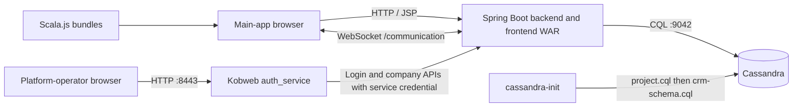

# DJC CRM

DJC CRM is a JVM-based CRM product being built for businesses that pay to use it. The platform operator manages those businesses and their employees through `auth_service`; employees will use the main CRM to manage their own customers, work, and communications.

The project started as a real-time chat application. It now has a separate administration/authentication webapp, tenant-company storage, company list/create APIs, and schema foundations for customer relationship management. It is still in development: employee onboarding and tenant isolation are not implemented, several legacy account/chat paths need repair, and most customer-facing CRM workflows remain planned.

## Contents

- [Product direction and terminology](#product-direction-and-terminology)
- [Current implementation](#current-implementation)
- [Architecture and repository](#architecture-and-repository)
- [Technology constraints and stack](#technology-constraints-and-stack)
- [Running locally](#running-locally)
- [Configuration](#configuration)
- [Builds and tests](#builds-and-tests)
- [Data model and schema changes](#data-model-and-schema-changes)
- [HTTP and real-time interfaces](#http-and-real-time-interfaces)
- [Known limitations](#known-limitations)
- [Development priorities](#development-priorities)
- [Troubleshooting](#troubleshooting)

## Product direction and terminology

### Companies are tenants

A **Company** is a subscribing business that uses DJC CRM. It is not a customer record inside another business's CRM.

A **Customer Organization** is a business, prospect, or customer that a subscribing company manages. Contacts, deals, tasks, notes, and activities belong to that company's CRM data.

For example:

- DJC CRM's operator onboards Example Services as a **Company**.
- Example Services' employees have **User** identities and **Company memberships**.
- Example Services tracks Acme as a **Customer Organization**, with Jane at Acme as a **Contact**.
- An Example Services employee owns the Acme relationship and follows its tasks and deals.

| Term | Meaning |
|---|---|
| Company / tenant | A subscribing business using DJC CRM |
| User | A person with an application identity, credentials, and profile |
| Company membership / employee | A user's association with a company, including company-scoped role and record status |
| Customer organization / account | A customer or prospect managed inside a tenant's CRM |
| Contact | A person the tenant does business with; a contact does not require a login |
| Workspace | Legacy name in CRM schema keys; intended to refer to the tenant company's ID |
| Lead | A prospect that may be converted into a customer organization, contact, and deal |
| Deal / opportunity | A potential sale or outcome progressing through a pipeline |
| Activity | A timeline entry for an interaction or meaningful change |
| Notification | A persisted, recipient-specific update that can also be delivered live |

The intended mapping is `workspace_id = company_id` in future company-scoped CRM workflows. Existing CRM partition keys retain the name `workspace_id`; there is no additional workspace hierarchy. This naming convention alone does not enforce tenant isolation.

### Intended employee onboarding

The target onboarding flow is:

1. The platform operator creates a subscribing company in `auth_service`.
2. The operator provisions employee users and company memberships. Employees remain unverified until they complete registration.
3. An invitation is eventually sent to each employee's email address.
4. The employee follows the invitation to `register.jsp`, claims the provisioned identity, establishes credentials, and supplies registration/profile details.
5. Successful verification enables the intended company access. A fuller UserProfile flow comes later.

**This is the intended flow, not the current registration implementation.** Company and membership data structures exist, but employee provisioning, invitation storage/delivery, invitation acceptance, company-aware registration, and tenant access enforcement remain to be built. The existing registration flow was not changed by the tenant-model work.

Account verification is separate from `RecordStatus`. Company and membership records use the existing `Active` and `Disabled` values; those values do not mean “invited” or “email verified.” Company roles must also remain distinct from global platform roles.

### CRM goals

Once onboarding and access boundaries are reliable, the product should provide:

- Customer organizations and contacts with ownership, relationship history, and useful lookup.
- Leads, configurable pipelines, deals, and qualification/conversion workflows.
- Tasks, notes, reminders, and activity timelines attached to customer records.
- Record-linked conversations and internal collaboration.
- Persistent notifications for assignments, mentions, reminders, and important changes.
- Company administration and operations appropriate for a paid product.

Billing contact fields are stored today. Subscription management, payment collection, and billing automation are not implemented.

## Current implementation

“Partial” means code exists but the complete user journey is unfinished or blocked. A table or model does not imply working CRUD, authorization, or UI.

| Area | State | Current implementation |
|---|---|---|
| Tenant companies | Partial | Separate table, Java/Kotlin models, DTOs, validation, list/create APIs, and company form/list |
| Company memberships | Data model only | Company/user keys, role, `RecordStatus`, and timestamps; not connected to provisioning or login |
| Platform login | Partial | Kobweb login forwards to backend credential/Admin-role checks and creates an in-memory auth-service session |
| Main-app accounts | Partial | Login, logout, registration, and role/verification code exist; registration logic and remaining session consumers need repair |
| Company management UI | Partial | Creation submits to the API; success/error feedback, automatic list refresh, and edit behavior are unfinished |
| Legacy administration | Partial | Admin JSP and verification API exist; the page controller returns the view name as text |
| Chat | Partial | Global Chat seed, conversation/history code, WebSocket delivery, and soft deletion; session and authorization issues remain |
| Notifications | Backend partial | Persistence, list/count/read/archive APIs, and SSE; no application producers or browser integration |
| Customer organizations | Schema and projection models | Customer tables remain separate from tenant companies; no complete customer-management workflow |
| Contacts, leads, pipelines, deals | Schema only | Canonical records and query projections, without complete services/APIs/screens |
| Tasks, notes, activities, teams | Schema only | Storage/access-pattern definitions, without complete application workflows |
| Tests and delivery | Limited | Company mapping/API tests, auth JVM tests, Gradle builds, Compose, and development scripts; no tracked CI workflow |

See [known limitations](#known-limitations) before treating these features as ready for customer use.

## Architecture and repository

There are two browser applications and one backend persistence layer:



- **Main application:** Spring Boot backend with JSP views and Scala.js browser behavior, served on port `8080`.
- **Administration/authentication application:** Kotlin Multiplatform/Kobweb browser UI and JVM API handlers, served over **HTTP** on port `8443`.
- **Persistence:** Spring Data Cassandra in the backend. `auth_service` calls backend APIs rather than connecting to Cassandra directly.
- **Sessions:** Main-app and auth-service sessions are separate; signing into one does not establish the other's application session.

```text
djc-crm/
├── backend/          Spring Boot entry point, APIs, services, Cassandra models, tests
├── frontend/         JSP pages, MVC/database configuration, executable WAR packaging
├── scala_js/         Scala.js browser source and linking configuration
├── auth_service/     Kotlin shared models, browser pages, JVM API handlers, tests
├── cassandra/        Database image, bootstrap schemas, data-model documentation
├── scripts/          Shared Bash launcher setup
├── run-*.sh          Main-app, auth-service, and combined development launchers
├── reload-*.sh       Rebuild helpers for running development servers
├── Dockerfile        Main application image
├── docker-compose.yml
├── build.gradle      runApp and runAuth convenience tasks
└── settings.gradle   Four-module Gradle build
```

`frontend` depends on `backend`. Its `bootRun` and `bootWar` tasks link Scala.js first. The link task synchronizes generated ES modules into `frontend/src/main/webapp/static/js`; page entries are `shell.js`, `login.js`, `register.js`, `conversations.js`, and `admin.js`.

The auth image uses [isolated Gradle settings](auth_service/docker.settings.gradle) and `kobwebExport` to produce its site and server artifacts. See [auth-service Docker notes](auth_service/README.md).

## Technology constraints and stack

Application implementation stays in the JVM ecosystem:

- Java for backend services and persistence.
- Scala/Scala.js for the existing main-app browser code.
- Kotlin Multiplatform and Compose HTML/Kobweb for the administration/authentication application.
- Gradle for builds, with a Java-based database engine.

Scala.js and Kotlin/JS produce JavaScript for browsers. Node/npm tooling, CSS frameworks, JSP scripts, and browser libraries are build or UI dependencies; their presence does not change the implementation-language direction.

| Area | Configured technology |
|---|---|
| Java runtime/toolchain | Java 21 |
| Gradle wrapper | 9.7.0 |
| Backend | Spring Boot 3.5.5, Spring Web MVC, Spring Data Cassandra |
| Main-app views | JSP/JSTL, embedded Tomcat |
| Main-app browser code | Scala 3.7.3, Scala.js 1.22.0, scalajs-dom, Udash jQuery wrappers |
| Administration app | Kotlin 2.4.10, Kobweb 0.25.1, Compose HTML |
| Shared Kotlin serialization | kotlinx.serialization JSON 1.9.0 |
| Database | Cassandra 4.1.7 |
| Password hashing | jBCrypt 0.4 |
| Live transport | Jakarta WebSocket; Spring MVC SSE for notification backend |
| Styling | Tailwind/Font Awesome in the JSP UI; Bootstrap 5.3.8 in Kobweb |
| Packaging | Executable Spring Boot WAR; exported Kobweb site/server; Docker images |

### Database direction

**Cassandra is still the implemented database.** The repositories, entities, schema scripts, and Compose service depend on it.

A Java-based relational alternative such as H2 is under consideration to reduce development overhead from query-specific projections. No H2 dependency, relational schema, or migration has been implemented, and Cassandra should not be described as a permanent product requirement. A database change would require deliberate repository/model/query changes and a plan for any retained data.

Until that decision is implemented, Cassandra writes must maintain every affected projection. Adding another storage backend is not a connection-string-only change.

## Running locally

### Prerequisites

For an all-container run:

- Docker Engine/Desktop with Docker Compose v2.
- Sufficient memory for Cassandra and the two application builds.
- Network access for the first download of images and build dependencies.

For host-run development, also install JDK 21 and use the supplied Gradle wrapper. Bash, Git Bash, or WSL is needed for the launch/reload scripts. PowerShell examples below use `.\gradlew.bat`; use `./gradlew`, or `bash ./gradlew`, on a Bash-based host.

### Environment setup

If `.env` does not already exist, copy the example:

```powershell
Copy-Item .env.example .env
```

Edit the existing file rather than overwriting local values. For the default host-run setup, fill the URL components with:

```dotenv
CRM_BACKEND_PROTOCOL=http
CRM_BACKEND_HOSTNAME=localhost
CRM_BACKEND_PORT=8080
CRM_BACKEND_URL=http://localhost:8080

AUTH_SERVICE_PROTOCOL=http
AUTH_SERVICE_HOSTNAME=localhost
AUTH_SERVICE_PORT=8443
AUTH_SERVICE_URL=http://localhost:8443

AUTH_SERVICE_SECRET_KEY=replace-with-a-random-local-secret
```

Replace the secret placeholder with a non-empty random value shared by both webapps. Do not commit `.env`.

The checked-in example constructs URLs from initially blank components. Sourcing it unchanged can produce a non-empty but invalid `CRM_BACKEND_URL` such as `://:`, which overrides the auth service's fallback URL. Supply valid components, set an explicit URL as above, or leave `CRM_BACKEND_URL` empty to use the code defaults.

The `AUTH_SERVICE_PROTOCOL/HOSTNAME/PORT/URL` entries are currently unused by application source; they do not change Kobweb's listening port. That port is configured in [conf.yaml](auth_service/.kobweb/conf.yaml).

### Docker Compose

From the repository root:

```powershell
docker compose up -d --build
docker compose ps -a
```

| Service | Address / expected state |
|---|---|
| `app` | http://localhost:8080 — running |
| `auth_service` | http://localhost:8443/login — running; HTTP, not HTTPS |
| `cassandra` | `localhost:9042` — healthy |
| `cassandra-init` | Exited with code `0` after schema application |

Compose waits for Cassandra's health check, runs `project.cql` followed by `crm-schema.cql`, and then starts the main app. Auth waits for the app container to start, not for an application readiness check; an early login request may need to be retried.

Compose explicitly gives auth the backend URL `http://app:8080` and passes `AUTH_SERVICE_SECRET_KEY` to both webapps.

```powershell
docker compose logs -f app auth_service
docker compose logs -f cassandra cassandra-init
docker compose down
```

`down` retains the named Cassandra volume. **`docker compose down --volumes` deletes that database data**; use it only for an intentional disposable-development reset.

### First sign-in

The two login paths have different purposes:

- Main app: `/account/login` accepts username or email and password.
- Auth service: `/login` accepts an existing user's email/password and calls backend `/auth/login`, which currently requires the exact global `Admin` role.

The schema seeds roles and Global Chat, **not an administrator user**. There is no working first-run administrator setup or invitation onboarding yet. A fresh schema alone does not provide a login account. Existing development accounts and role assignments must be provisioned separately until that workflow is built; the current registration endpoint is not a reliable bootstrap path.

Seeded roles include `Super Admin`, `Company Admin`, `Admin`, `Moderator`, and `User`. Their names do not imply an implemented hierarchy: current auth-service login checks specifically for `Admin`.

### Host-run development

Start Cassandra and its schema initializer, then stop any containerized applications that would occupy the local ports:

```powershell
docker compose up -d cassandra cassandra-init
docker compose stop app auth_service
```

Use the Bash launchers to load `.env` and start the applications:

```bash
bash run-dev.sh       # Start auth and main app; Ctrl+C stops the combined run
bash run-app.sh       # Main application only
bash run-auth.sh      # Auth only; Ctrl+C stops its Kobweb server
```

These scripts require a trusted, Bash-compatible `.env` and handle CRLF line endings. They resolve paths relative to the repository; invoke the script by its path if your shell is elsewhere. They do not start Cassandra.

`run-auth.sh` follows Kobweb's built-in Logback file; `run-dev.sh` displays that
output alongside unchanged Spring Boot console logging. Both use the ordinary
`kobwebStart` task. Stop the old launcher/server once before switching.

Auth logging is configured under `server.logging` in `auth_service/.kobweb/conf.yaml`.
Kobweb 0.25.1 supplies the console and rolling-file appenders directly; no custom Logback configuration is needed. This upgrade also eliminates the fallback-page `CompressedReadChannelResponse` to `Unit` cast failure reproduced with 0.25.0.
The active file is `auth_service/build/logs/auth.log`. Logs are cleared on a fresh
server start, and daily rotation is enabled while it runs. The launchers follow
file replacement/rotation; `reload-auth.sh` keeps using the same running server.
The level is `INFO`; change it to `DEBUG` and restart to see debug messages.
Kobweb 0.25.1 also forwards API `println` / `System.err` output to INFO/WARN logs.
Prefer `context.logger` for explicit levels and exception reporting. `jsMain` output
still appears in the browser console.

Stores and other JVM classes receive only the logger through constructor injection:

```kotlin
import com.varabyte.kobweb.api.log.Logger

class ExampleStore(private val logger: Logger) {
    fun doWork() {
        logger.info("ExampleStore: starting work")
        // Inside an error handler:
        // logger.error("ExampleStore: failed\n${exception.stackTraceToString()}")
    }
}

// Inside an API handler:
val store = ExampleStore(context.logger)
```

`CompanyStore` and `UserStore` follow this pattern. They do not retain `ApiContext`,
cookies, or the request. For services created outside a request, construct them in
an `@InitApi` function using `InitApiContext.logger`, and pass that logger to their
dependencies. Tests can inject an implementation of Kobweb's `Logger` to record
messages. No additional logging dependency or global logger is needed.

To save the combined terminal output as well, use
`bash run-dev.sh 2>&1 | tee dev-console.log` (keep local logs out of Git).

Alternatively, export the environment variables into each terminal and run Gradle directly:

```powershell
.\gradlew.bat runApp
# In a separate terminal:
.\gradlew.bat runAuth
```

Direct Gradle commands do not load `.env`. Auth's shared secret must match the one in the main app's process environment. Kobweb may continue running after its Gradle start task returns; stop it with:

```powershell
.\gradlew.bat :auth_service:kobwebStop
```

Host-run applications use `localhost:9042` for Cassandra. Containers use `cassandra:9042`.

### Reloading code

With a launcher running, rebuild from another terminal:

```bash
bash reload-app.sh
bash reload-auth.sh
```

- App reload compiles Java/resources, links Scala.js, and signals a DevTools restart after the build succeeds. Active requests and WebSocket connections can be interrupted.
- Auth reload rebuilds using `kobwebReuseServer=true`. It starts a server if one is not already running.
- Refresh the browser after UI changes.
- Environment variables, dependencies, and startup configuration can require a full stop/start.
- Do not start two launchers for the same service.

Extra main-app arguments can be passed through, for example `bash run-app.sh --args=--server.port=8081`. Update the auth backend URL when changing the main-app port.

## Configuration

Main-app Cassandra and MVC settings live in [frontend application.yml](frontend/src/main/resources/application.yml). Backend error settings live in [backend application.yml](backend/src/main/resources/application.yml). Auth reads its backend connection settings directly from the environment.

| Variable | Code default | Purpose |
|---|---|---|
| `CASSANDRA_CONTACT_POINTS` | `localhost` | Host-run database contact point |
| `CASSANDRA_PORT` | `9042` | Database port |
| `CASSANDRA_KEYSPACE_NAME` | `mykeyspacename` | Application keyspace |
| `CASSANDRA_LOCAL_DATACENTER` | `datacenter1` | Cassandra driver datacenter |
| `CASSANDRA_SCHEMA_ACTION` | `NONE` | Spring Data schema behavior |
| `AUTH_SERVICE_SECRET_KEY` | Unset | Shared server-side credential for backend `/auth/*` |
| `CRM_BACKEND_PROTOCOL` | `http` | Used when constructing the fallback auth-to-backend URL |
| `CRM_BACKEND_HOSTNAME` | `localhost` | Fallback backend host |
| `CRM_BACKEND_PORT` | `8080` | Fallback backend port |
| `CRM_BACKEND_URL` | Built from the preceding three values | Nonblank explicit value takes precedence |

Compose supplies `SPRING_CASSANDRA_*` properties directly, overriding the local database address.

Keep `schema-action: NONE` while the CQL scripts own schema creation. The message projection is a materialized view; automatic table creation can conflict with it.

## Builds and tests

### Build commands

```powershell
# Main application WAR, including linked Scala.js:
.\gradlew.bat :frontend:bootWar

# Relink only the Scala.js output:
.\gradlew.bat :scala_js:link

# Compile both auth targets:
.\gradlew.bat :auth_service:compileKotlinJvm :auth_service:compileKotlinJs

# Auth browser production bundle and available checks:
.\gradlew.bat :auth_service:authBundle
.\gradlew.bat :auth_service:authCheck

# Container images and Compose syntax:
docker compose build app auth_service
docker compose config --quiet
```

The WAR is written under `frontend/build/libs/`. `authBundle` produces browser output, not the complete server deployment; the auth Dockerfile exports the full site/server.

### Automated tests

```powershell
.\gradlew.bat :backend:test
.\gradlew.bat :auth_service:jvmTest
```

Current coverage:

| Test area | Coverage |
|---|---|
| Backend company mapping | Tenant key, frozen billing address, membership keys, and existing `RecordStatus` conversion |
| Backend company API | Minimal creation, saved response/IDs/timestamps, and status validation |
| Auth company serialization | Java-compatible company JSON and separate membership data |
| Auth sessions | Token expiry/rotation, response acceptance, and cookie attributes |
| Auth HTTP client | Methods, headers, authentication, response bodies, cookies, redirects, and timeouts |

Company-only auth checks can be run with:

```powershell
.\gradlew.bat :auth_service:jvmTest --tests com.auth_service.model.CompanySerializationTest
```

**Known test failure:** `AuthSessionsTest` currently expects an empty HTTP `200` response to count as successful login. The implementation requires a JSON `success: true` result, so that assertion fails. The full auth JVM suite is therefore not green. At this README verification, the backend checks passed, auth ran 12 tests with one failure, and Kotlin/JS compilation succeeded.

These tests do not establish end-to-end tenant isolation, live Cassandra persistence, browser behavior, or Docker deployment health. The backend company API test uses a mocked service, and the mapping test uses a Cassandra converter without a running database. There is no tracked CI workflow or comprehensive HTTP/WebSocket/browser integration suite.

## Data model and schema changes

### Tenant storage

| Table | Purpose |
|---|---|
| `companies_by_id` | Tenant business identity, legal name, billing/contact details, optional primary-admin reference, status, and audit fields |
| `company_users_by_company` | Membership keyed by company/user, with company-scoped role, status, and timestamps |

The Java `Company` and Kotlin `Company` represent subscribing businesses. Customer-sales fields such as industry, employee count, annual revenue, parent organization, and shipping address do not belong to these tenant records.

Company creation assigns its ID and timestamps in the backend. Actor audit IDs remain optional until operator identity is propagated to writes. The service credential is not an operator identity.

`CompanyUser` represents membership; credentials, email verification, and profile remain on the user. Kotlin's `companyUsers` property is transient and is not embedded in the company row. Membership provisioning and permission enforcement are future work. Setting `primary_admin_user_id` does not create membership or grant access.

Both company and membership status use [RecordStatus](backend/src/main/java/com/brewery/web/model/record/RecordStatus.java): Java `ACTIVE` / `DISABLED` map to persisted `Active` / `Disabled`. There is no separate company-status enum.

### Customer CRM storage

These tables describe future customer workflows. They do not represent the businesses subscribing to DJC CRM.

| Domain | Canonical table | Main read projections |
|---|---|---|
| Customer organizations | `crm_organizations_by_id` | Owner, normalized name, email domain |
| Contacts | `crm_contacts_by_id` | Organization, owner, email |
| Leads | `crm_leads_by_id` | Owner/status, email |
| Pipelines | `crm_pipelines_by_id` | Workspace list and ordered stages |
| Deals | `crm_deals_by_id` | Pipeline/stage, owner/status, organization, contact |
| Tasks | `crm_tasks_by_id` | Owner/due month and related entity |
| Notes | `crm_notes_by_id` | Related entity timeline |
| Activities | `crm_activities_by_id` | Related entity and owner/day |
| Teams | `crm_teams_by_id` | Workspace, team members, user memberships |

Customer-organization projection classes live under `backend/.../model/organization`. The canonical tables and projections must be kept consistent by application writes. When a primary-key field changes, delete the old projection row and insert the new one. Cassandra does not enforce relational ownership or tenant foreign keys.

### Existing chat and notification storage

[project.cql](cassandra/project.cql) defines users, credentials, roles, user roles, conversations, messages, and the `events` / `events_by_type` / `unread_events` notification tables. It also creates `messages_by_conversation_id` and seeds Global Chat and the global role labels.

The local keyspace uses a single `datacenter1` replica. The custom Cassandra image enables materialized views for the message projection.

`NotificationService` writes notification projections and publishes SSE updates after writes. Current limitations include partial-write recovery, no application producers or browser consumer, no cross-instance fan-out, and no reminder/expiry worker. Expired records are hidden from lists but can remain in unread counts. See [notification API documentation](backend/SSE-README.md); the session issue below currently also affects those endpoints.

### Applying schema changes

Compose applies [project.cql](cassandra/project.cql) and then [crm-schema.cql](cassandra/crm-schema.cql). For an existing running local database:

```powershell
docker compose run --rm cassandra-init
```

The tenant-company tables are additive. Previously created “company” rows in `crm_organizations_by_id` are **not migrated automatically**. The tenant company screen now reads `companies_by_id`; an empty list after this change does not mean the old organization data was deleted.

`CREATE TABLE IF NOT EXISTS` does not alter existing table definitions. Retained data needs explicit migrations; bootstrap scripts are not a versioned migration system. Do not reset database volumes to resolve schema differences when the data must be preserved.

Further details:

- [Tenant company model and migration notes](cassandra/TENANT_COMPANIES.md)
- [CRM schema conventions](cassandra/CRM_SCHEMA.md)
- [CQL query examples](cassandra/crm-query-examples.cql)

Inspect the database with:

```powershell
docker compose exec cassandra cqlsh
```

```sql
USE mykeyspacename;
DESCRIBE TABLES;
SELECT * FROM companies_by_id;
SELECT * FROM roles;
```

## HTTP and real-time interfaces

These are implemented routes, not a guarantee that each complete workflow currently succeeds.

### Administration/auth service — port 8443

| Method | Path | Purpose |
|---|---|---|
| `GET` | `/login` | Platform sign-in page |
| `POST` | `/api/login` | Forward credentials to the backend and establish auth session |
| `GET` | `/api/session` | Check auth-service session |
| `GET` | `/company` | Tenant company list/create UI |
| `GET` | `/api/company/get/all` | Forward company listing to backend |
| `POST` | `/api/company/add` | Forward tenant creation and return saved company |

The Kobweb API interceptor requires an auth-service session for API routes other than login. The browser route guard also checks `/api/session` before rendering private pages.

### Backend administration APIs — port 8080

| Method used | Path | Purpose |
|---|---|---|
| `POST` | `/auth/login` | Email/password and global Admin-role check |
| `GET` | `/auth/company/all` | List tenant companies |
| `POST` | `/auth/company/add` | Create tenant company and return `success` / `data` |

These routes require `X-Auth-Service-Secret-Key`. Missing server configuration returns `503`; an invalid credential returns `401`. The secret authenticates the calling service, not a user or company. Backend company routes currently do not enforce per-operator or tenant permissions. The login handler uses `@RequestMapping` without restricting its HTTP method, although the auth service calls it with POST.

### Main application — port 8080

| Method | Path | Purpose |
|---|---|---|
| `GET` | `/`, `/global-chat` | Landing page / Global Chat redirect |
| `GET` | `/conversations?conversationId=...` | Conversation view/history |
| `GET/POST` | `/account/login` | Login page / JSON login |
| `GET/POST` | `/account/register` | Existing registration page / form submission |
| `POST` | `/account/logout`, `/account/roles` | Logout / current roles |
| `GET/POST` | `/account/forgot-password` | Page / unimplemented reset submission |
| `GET` | `/message` | Older messages by conversation/date |
| `DELETE` | `/message/delete` | Soft-delete message |
| `POST` | `/add-friend` | Incomplete direct-conversation creation |
| `GET` | `/admin/login` | Intended admin page; rendering is currently broken |
| `POST` | `/admin/user/verify` | Existing account-verification endpoint |
| `GET` | `/api/events`, `/api/events/count` | Notifications / unread count |
| `GET` | `/api/events/stream` | SSE connection |
| `PATCH` | `/api/events/{eventId}/read`, `/api/events/read-all` | Read operations |
| `PATCH` | `/api/events/{eventId}/archive` | Archive notification |
| WebSocket | `/communication` | Live chat |

## Known limitations

### Identity, registration, and access

- **Incomplete session migration:** login stores `SessionUser` and `AuthHook` now accepts it, but conversation, deletion, roles, and notification handlers still cast it to `User`. Some JSPs also use the old type.
- **Registration does not claim invited users:** the current controller requires the submitted email and username to already exist, then calls a service that creates a new user. This is neither a functioning self-registration policy nor the planned invitation flow.
- **Verification policy differs from the goal:** the current registration service marks new users `VERIFIED`, while the message verification check in `AuthHook` is commented out.
- **Separate auth sessions:** main-app servlet sessions use `current_user` and a 30-minute timeout. Auth-service tokens have a fixed 30-minute lifetime, are held in memory, and disappear on restart. Their stored value is expiry, not a user/company identity. Backend auth login separately stores `auth_user`.
- **Login error handling:** backend `/auth/login` does not return its constructed validation error and can dereference a null user after incorrect credentials.
- **No enforced company boundary:** company/membership fields and schema keys exist, but login, customer APIs, and legacy chat do not yet enforce company membership. Global Chat remains a shared legacy concept and needs a deliberate policy before serving multiple companies.

### Application completion

- Company listing currently uses `findAll` without pagination. The UI suppresses some errors, does not refresh automatically after creation, and has an edit button that only logs to the console.
- The legacy admin handler is a `@RestController` returning `admin/admin-index` as text. It is mapped to `/admin/login`, not a working `/admin` page.
- `/add-friend` constructs a conversation but its persistence call is commented out.
- `/account` is unfinished; password-reset POST returns `501 Not Implemented`.
- Notifications need producers, a browser inbox, projection recovery, and runtime SSE validation. Filter registration does not explicitly configure async support.
- Customer CRM tables are ahead of their application services and UI.

### Before customer deployment

The current Compose stack is for local development. In addition to completing onboarding and tenancy:

- Derive WebSocket sender identity and destination authorization from server-side authentication. The current endpoint accepts user/conversation query parameters, and message writes trust sender/conversation fields in JSON.
- Check conversation membership on history reads; the current older-message endpoint lacks that check.
- Establish consistent authorization, CSRF protection, input validation, and session/credential lifecycle controls.
- Remove verbose exception/stack-trace responses from production configuration.
- Add database authentication, transport security, backups, migration/recovery procedures, and an appropriate replication topology.
- Add application readiness checks, operational visibility, and tests covering tenant isolation and critical user journeys.

These are outstanding implementation requirements, not capabilities implied by the presence of tables or role names.

## Development priorities

### 1. Stabilize the existing foundation

Complete the session migration, fix login/registration error handling, repair legacy admin rendering, and make the relevant test suites green. Establish the boundary between platform-operator identity and company employees. Resolve the database direction before substantially expanding persistence code.

### 2. Complete company onboarding

Build operator-managed employee provisioning and company memberships. Add invitation data and delivery, then adapt `register.jsp` to claim a provisioned identity and verify the invitation. Keep company access, record status, and email verification separate. Implement company-scoped permissions before exposing tenant data.

### 3. Deliver a complete customer workflow

Allow an authorized employee to create a customer organization, add a contact, attach a note and task, and reopen the record with its history intact. Verify that another company's employee cannot read or modify it. Add usable validation, loading/error states, and persistent edits.

### 4. Expand CRM capabilities

Implement leads and conversion, pipelines and deals, activity history, and record-linked collaboration. Connect meaningful events to the existing notification backend and add the browser inbox and reminder processing.

### 5. Prepare the paid service for operation

Implement profile customization, account administration, subscription/billing workflows as required, versioned migrations, CI, monitoring, backups, and deployment/recovery procedures. Broader profile customization follows the initial registration/onboarding work.

An initial customer-ready release requires reliable onboarding, enforced company isolation, useful customer records/work tracking, and repeatable operation. The larger CRM roadmap should not obscure those first complete user journeys.

## Login rate limiting

Direct `POST /account/login` requests in the backend and `POST /api/login` requests in the auth service
use separate per-IP token buckets (Bucket4j with a bounded Caffeine cache). Each IP starts with 10 tokens
and refills one token every two seconds, up to 10. Every POST attempt counts, including successful and
malformed requests. GET requests do not consume tokens.

Exhausted buckets return HTTP `429`, `Retry-After` in seconds, and `Cache-Control: no-store` before
controller/database/password work or backend forwarding. The JSON body uses the normal
`success: false`, `message`, `data: null` response envelope. Authenticated company/user APIs are not
covered by this login policy.

The backend filter is registered only for `/account/login`. The auth-service interceptor checks `/api/login`
at its public entry point; do not apply a backend IP bucket to forwarded `/auth/login` requests, since
all users would share the auth service's IP. Both checks use the connection's peer address and do not
parse `X-Forwarded-For`. If deploying behind a reverse proxy, configure trusted client-address handling
or enforce client-IP limits at the proxy; otherwise users behind it share an allowance.

Each process stores at most 10,000 buckets, expiring entries after 10 minutes of inactivity. Restarting
or evicting entries resets their allowances. These are single-instance limits, not distributed quotas;
multiple instances need shared state or gateway enforcement. Account-based failed-attempt cooldowns
and registration/email throttling remain separate future work.

## Troubleshooting

| Symptom | Check |
|---|---|
| Auth login returns `503` | Both webapps need the same non-empty `AUTH_SERVICE_SECRET_KEY`; restart after changing it |
| Auth cannot reach backend | Use a valid `CRM_BACKEND_URL`; host default is `http://localhost:8080`, Compose uses `http://app:8080` |
| Fresh install has no administrator login | Seed scripts create role labels, not users; operator provisioning is still unfinished |
| Port `8080` or `8443` is occupied | Stop the corresponding Compose app or local launcher before starting another |
| Host app cannot reach Cassandra | Use `localhost:9042`, not the Compose-only hostname `cassandra`; inspect database health/init logs |
| `cassandra-init` exited | Exit `0` is expected; inspect its logs for any nonzero exit |
| Company list becomes empty after tenant-model change | Apply the additive schema and review [old organization data](cassandra/TENANT_COMPANIES.md); it was not migrated |
| Main login succeeds but a protected feature fails | Check remaining `User` casts of the `SessionUser` session attribute |
| Enum conversion fails for `Active` | Ensure the registered `RecordStatus` Cassandra converters are included in the running build |
| Existing table did not change | `IF NOT EXISTS` is not a schema migration; use an explicit change for retained data |
| Browser uses stale code | Run the appropriate reload script; Scala.js can also be relinked with `:scala_js:link` |
| Auth JVM tests fail on empty successful response | See the known `AuthSessionsTest` assertion mismatch in [Builds and tests](#builds-and-tests) |

If changing Cassandra's host-side port mapping, update `CASSANDRA_PORT` for host-run apps. Compose applications continue using the internal database port.

## Development conventions

- Keep maintained application logic in Java, Scala, or Kotlin.
- Keep tenant companies and customer organizations distinct in names, models, APIs, and documentation.
- Reuse `RecordStatus` for active/disabled record state; do not use it as a substitute for verification.
- Keep credentials and profile on users, membership/roles on their appropriate association, and business details on companies.
- Treat backend validation and authorization as authoritative; browser guards are not sufficient.
- Assign identity and audit metadata deliberately; do not treat a shared service secret as a user identity.
- Until storage changes, maintain Cassandra projections explicitly and test key changes and partial failures.
- Edit Scala source rather than generated JS. Keep hand-maintained vendor assets outside the synchronized generated directory.
- Keep secrets out of source control, and describe unfinished behavior as unfinished.

## License

No license file is currently included in the repository.
